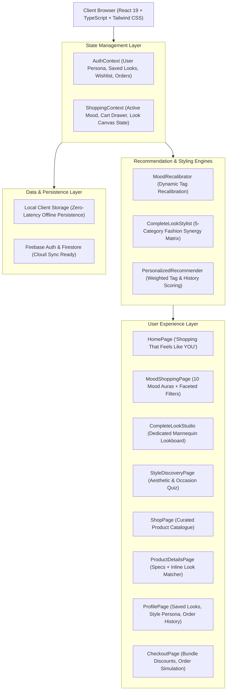

# AURA & ATELIER ✦ Technical Project Report & Faculty Presentation Guide

**Project Title:** AURA & ATELIER — Intelligent Mood-Based Fashion Atelier & Automated Personal Styling Platform  
**Live Production Prototype:** [https://shopping-alpha-pied.vercel.app](https://shopping-alpha-pied.vercel.app)  
**GitHub Repository:** [https://github.com/Snigdha-0210/shopping](https://github.com/Snigdha-0210/shopping)  
**Author / Presenter:** Snigdha Gorai  
**Category:** Full-Stack Web Application / E-Commerce AI-Inspired Recommendation System  

---

## Executive Summary

Traditional online shopping platforms present consumers with overwhelming, cold product grids, generic categorical dropdowns, and uninspired filtering mechanisms. This causes decision fatigue and fails to replicate the emotional, curated experience of walking into a luxury fashion boutique.

**AURA & ATELIER** solves this paradigm through an emotional-first architecture driven by two signature innovations:
1. **Mood-Based Shopping Engine:** Dynamically recalibrates the entire catalog, aesthetic aura, color palettes, and editorial copywriting to match how the shopper feels right now across 10 distinct mood identities.
2. **"Complete My Look" Automated Styling Matrix:** An algorithmic personal stylist that takes any single anchor product (clothing, shoes, or accessories) and intelligently harmonizes a 5-piece cohesive outfit (Clothing, Footwear, Bags, Jewellery, Accessories) with an automated **15% bundle discount incentive**.

---

## 1. Complete Technology Stack & Architectural Decisions

| Layer / Concern | Technology Chosen | Version | Architectural Justification & Advantages |
| :--- | :--- | :--- | :--- |
| **Frontend Library** | **React** | `v19.0.0` | Utilizes React 19's optimized virtual DOM reconciliation, concurrent rendering capabilities, and modern functional hooks (`useState`, `useEffect`, `useContext`, `useMemo`, `useCallback`) to eliminate unnecessary re-renders during live outfit customization. |
| **Programming Language** | **TypeScript** | `v5.7.2` | Enforces compile-time type safety across all domain models (`Product`, `CartItem`, `LookBundle`, `MoodType`, `AestheticType`). Eliminates runtime type errors and ensures reliable data contracts throughout recommendation algorithms. |
| **Build Tooling & Bundler** | **Vite** | `v6.1.0` | Uses native ES Modules (ESM) during development for sub-millisecond Hot Module Replacement (HMR) and leverages Rollup for production tree-shaking, code-splitting, and CSS minification (bundle gzip size < 140 kB). |
| **Styling & Design System** | **Tailwind CSS** + **PostCSS** | `v3.4.17` | Utility-first CSS architecture with custom luxury tokens (`warm-ivory`, `soft-taupe`, `noir-charcoal`, `gold-accents`). Incorporates backdrop-blur glassmorphism (`glass-nav`, `glass-card`) and custom low-profile scrollbars without external UI bloat. |
| **Client-Side Routing** | **React Router DOM** | `v7.1.5` | Handles seamless single-page application (SPA) client-side routing with nested dynamic paths (`/complete-look/:productId`, `/product/:id`), scroll-restoration hooks, and zero full-page browser reloads. |
| **State Management** | **React Context API** (Dual Context) | Native | Avoids Redux boilerplate while maintaining clean separation of concerns: `ShoppingContext` handles cart operations, active moods, and lookbuilder state; `AuthContext` manages user personas, saved lookbooks, and wishlists. |
| **Animation & Micro-interactions** | **Framer Motion** + **Canvas-Confetti** | `v12.4.7` / `v1.9.4` | Physics-based spring animations for drawer slides, modal reveals, and celebratory confetti upon completing look bundles or saving personal lookbooks. |
| **Iconography** | **Lucide React** | `v1.16.0` | Tree-shakeable, feather-weight SVG icon library ensuring fast render times without loading entire font icon packs. |
| **Backend & Cloud Services** | **Firebase** (Auth & Firestore) | `v11.3.1` | Client-SDK integration for Google/email authentication and Firestore cloud sync, engineered with a zero-config fallback to `localStorage` when offline. |
| **Deployment & Hosting** | **Vercel Edge Network** | Production | Continuous CI/CD deployment on every Git push with automated edge routing via `vercel.json` rewrites to prevent 404s on deep React Router links. |

---

## 2. System Architecture & Component Hierarchy



---

## 3. Core Algorithms Explained

### 3.1 The "Complete My Look" Harmonization Engine

When a customer selects a hero anchor product, the styling engine executes a weighted multi-attribute compatibility scoring function against every candidate item in the catalog:

$$\text{Score}(C) = (M \times 25) + (A \times 20) + (O \times 15) + (K \times 10) + (E \times 12)$$

Where:
- **$M$ (Mood Alignment):** Number of overlapping mood tags between Candidate $C$ and Hero Product $H$.
- **$A$ (Aesthetic Alignment):** Shared aesthetic tags (e.g., *Old Money*, *Clean Girl*, *Quiet Luxury*).
- **$O$ (Occasion Match):** Matching target occasion (e.g., *Cocktail Party*, *Workplace*, *Resort Vacation*).
- **$K$ (Color Synergy):** Palette harmonic compatibility matching hex codes or complementary neutral families.
- **$E$ (Editorial Synergy):** Bonus score if both items belong to the same curated editorial collection.

#### Category Harmonization Matrix
The engine groups ranked candidates into 5 specific fashion categories:
1. **Clothing** (Layering jackets, blazers, trousers, skirts)
2. **Footwear** (Stilettos, Blake-stitched loafers, court sneakers)
3. **Bags** (Box calfskin leather totes, crystal evening minaudières)
4. **Jewellery** (Baroque pearls, tennis bracelets, Swiss timepieces)
5. **Accessories** (Silk twill scarves, beveled cat-eye acetate frames)

The top-scoring item in each category forms the **Default Curated Look**, while the interactive mannequin canvas allows the customer to toggle, swap, or remove individual pieces with real-time recalculation of the **15% bundle savings**.

---

### 3.2 Mood Recalibration Engine

The platform defines **10 Distinct Mood Identities**:

| Mood Identity | Atmosphere & Aura | Representative Silhouette | Stylist Keynotes |
| :--- | :--- | :--- | :--- |
| **Elegant** | Timeless Grace & Poise | Mulberry Silk Cowl Backless Gown | Silk slips, tailored blazers, stiletto pumps, baroque pearls |
| **Casual** | Daily Ease & Composure | Relaxed Cotton Poplin & Rigid Denim | Oversized shirting, 90s straight denim, suede court trainers |
| **Party** | Electrifying Nightfall Radiance | Midnight Sequin Halter Mini Dress | Metallic strappy heels, crystal minaudière, tennis bracelet |
| **Luxury** | Opulent Master Craftsmanship | Double-Breasted Virgin Wool Blazer | Swiss horology watches, French calfskin, leather loafers |
| **Minimal** | Purity of Form & Restraint | Pleated Wide-Leg Crepe Trousers | Architectural cuts, boxy poplin, monochromatic bands |
| **Streetwear** | Contemporary Urban Edge | 480gsm Loopback Boxy Hoodie | Parachute pants, technical nylon, industrial silver hoops |
| **Chic** | Parisian Allure & Modernity | Archival Houndstooth Cropped Jacket | Pointed kitten heels, beveled cat-eyes, baguette bag |
| **Vintage** | Heritage Romance & Silhouettes | Hand-Rolled Silk Twill Heritage Scarf | Goodyear-welted loafers, brass hardware, Irish tweed |
| **Romantic** | Ethereal Tones & Whimsical Drapery | Tiered Floral Gossamer Chiffon Maxi | Smocked bodices, pearl chokers, ribbon ankle-tie sandals |
| **Sporty** | Dynamic Athletic Precision | 4-Way Stretch Compression Tank | Aerodynamic outerwear, performance knit runners |

---

## 4. State Management & Data Flow Architecture

The application adopts a **Dual Context Provider pattern** wrapped at the root in `App.tsx`:

```
<AuthProvider>
  <ShoppingProvider>
    <Router>
      <AppContent />
    </Router>
  </ShoppingProvider>
</AuthProvider>
```

1. **`ShoppingContext`**:
   - Manages live `activeMood`, `activeAesthetic`, and `activeOccasion`.
   - Coordinates the shopping cart, drawer open/close triggers, subtotal calculations, and bundle discounts.
   - Holds the `stylingHeroProduct` state for opening the interactive lookbuilder canvas from anywhere in the application.
   - Serializes cart state to browser `localStorage` on every mutation to preserve customer selections across browser reloads.

2. **`AuthContext`**:
   - Tracks authenticated user profiles, personalized style personas, and saved lookbooks.
   - Provides mock 1-click test credentials alongside Firebase integration for zero-friction demonstrations.

---

## 5. UI/UX Design System & Sensory Aesthetics

1. **Color Palette:**
   - Primary Background: Warm Ivory (`#FAF8F5`, `#F5F2EB`)
   - Text & Contrast: Noir Charcoal (`#171615`, `#292524`)
   - Accent & Glamour: Warm Atelier Gold (`#D4AF37`, `#C5A880`)
2. **Typography Hierarchy:**
   - Headings & Editorial Titles: *Playfair Display* & *Cormorant Garamond* (Google Web Fonts)
   - Interface, Body & Numbers: *Plus Jakarta Sans* & *Inter*
3. **Glassmorphic Atmosphere:**
   - Sticky navigation and floating lookboards use `-webkit-backdrop-filter: blur(12px)` with subtle rgba translucent ivory fills (`rgba(250, 248, 245, 0.88)`).

---

## 6. Faculty Viva Voce & Presentation Q&A Preparation

### Q1: Why did you choose React 19 and TypeScript instead of standard vanilla JavaScript or simple HTML/CSS?
> **Answer:** *"React 19 provides component-based reusability, virtual DOM diffing, and declarative state management, which are essential for an interactive e-commerce platform where selecting an outfit item immediately updates prices, discounts, and visual lookboards without refreshing the page. TypeScript introduces compile-time type safety. With complex data models like products having multiple moods, aesthetics, colors, and 5 separate category combinations, TypeScript prevents null-pointer bugs and type mismatches before the code ever reaches production."*

### Q2: How does the "Complete My Look" algorithm work under the hood?
> **Answer:** *"The engine takes the selected anchor product and calculates a fashion affinity score for every candidate item in the catalog. The scoring is weighted: Mood alignment carries 25 points, Aesthetic compatibility carries 20 points, Occasion alignment carries 15 points, Color synergy carries 10 points, and shared Editorial collection gives 12 bonus points. The algorithm filters candidates across 5 categories—Clothing, Footwear, Bags, Jewellery, and Accessories—selects the highest-ranking item in each, and applies an automated 15% bundle discount to incentivize total-look purchases."*

### Q3: How is state preserved if the user refreshes the page?
> **Answer:** *"We implemented a two-tiered persistence strategy. Primary cart state, active mood choices, and custom lookbooks are continuously synchronized to browser `localStorage` via `useEffect` hooks. For multi-device persistence, the application connects to Firebase Authentication and Cloud Firestore, while gracefully falling back to local storage if offline or unauthenticated."*

### Q4: How is single-page routing handled when deployed on Vercel?
> **Answer:** *"In client-side single-page applications built with React Router, navigating to deep URLs like `/complete-look` directly in the browser address bar can result in a 404 error if the web server looks for a physical directory. We configured a `vercel.json` rewrite rule with source `/(.*)` pointing to `/index.html`. This tells Vercel to route all traffic through the single root page where React Router intercepts the URL and mounts the correct page view seamlessly."*

### Q5: How did you ensure fast loading times with high-resolution fashion imagery?
> **Answer:** *"We used Vite as our bundler, which performs tree-shaking and dynamic chunk splitting, resulting in a production JavaScript bundle of only ~136 kB gzipped. All photography is hosted on Unsplash CDN utilizing responsive query parameters (`auto=format&fit=crop&w=...&q=80`) to serve modern WebP/AVIF images tailored to the client's screen size without bandwidth bloat."*

---

## 7. Project Execution Commands

```bash
# Clone the repository
git clone https://github.com/Snigdha-0210/shopping.git

# Navigate into the project folder
cd shopping

# Install all dependencies
npm install

# Start development server
npm run dev
# Server launches on http://localhost:5173

# Execute TypeScript type check and production build
npm run build
```
