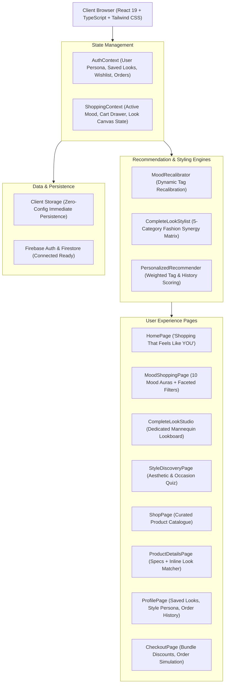
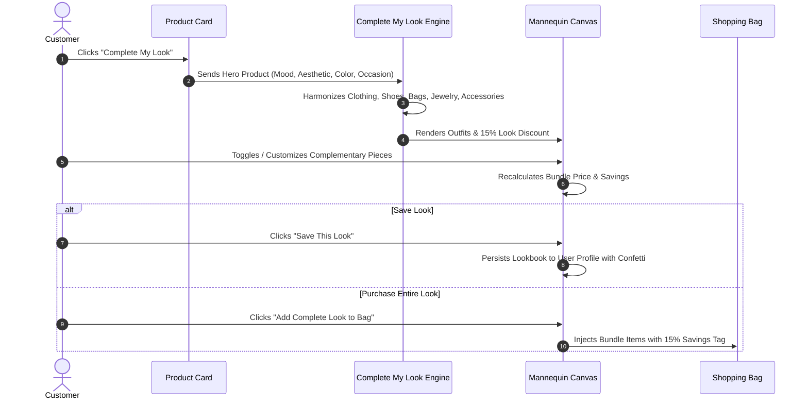

<div align="center">


# AURA & ATELIER
### *“Shopping That Feels Like YOU.”*
**An intelligent luxury fashion atelier pairing real-time mood alignment with automated 5-category personal styling.**

<br />

[](https://shopping-alpha-pied.vercel.app/)

<br />

[](https://react.dev/)
[](https://www.typescriptlang.org/)
[](https://tailwindcss.com/)
[](LICENSE)

<br />

[**Explore Live Prototype**](https://shopping-alpha-pied.vercel.app/) • [**System Architecture**](#-system-architecture) • [**Complete My Look Engine**](#-signature-feature-2-complete-my-look) • [**The 10 Moods Matrix**](#-the-10-moods-matrix)

</div>

---

## 📑 Table of Contents

- [Concept & Philosophy](#-concept--philosophy)
- [Signature Features](#-signature-features)
  - [1. Mood-Based Shopping](#-signature-feature-1-mood-based-shopping)
  - [2. Complete My Look Studio](#-signature-feature-2-complete-my-look)
  - [3. Find Your Aesthetic](#-feature-3-find-your-aesthetic)
  - [4. Smart Recommendation Engine](#-feature-4-smart-recommendation-engine)
  - [5. Editorial Collections & Lookbooks](#-feature-5-editorial-collections--lookbooks)
- [Visual Experience Preview](#-visual-experience-preview)
- [System Architecture](#-system-architecture)
- [Algorithmic Styling Flow](#-algorithmic-styling-flow)
- [The 10 Moods Matrix (Visual Table)](#-the-10-moods-matrix)
- [Curated Aesthetics & Occasions](#-curated-aesthetics--occasions)
- [Color System & Typography](#-color-system--typography)
- [Directory Structure](#-directory-structure)
- [Getting Started Locally](#-getting-started-locally)
- [Deployment on Vercel](#-deployment-on-vercel)
- [License](#-license)

---

## 🕊 Concept & Philosophy

Traditional e-commerce platforms present cold grids, endless categories, and generic filters. **AURA & ATELIER** replaces that friction with an intuitive luxury boutique experience guided by emotion and curated by an intelligent personal stylist.

The entire experience revolves around two foundational pillars:
1. **Mood-Based Shopping**: Shop according to how you feel right now.
2. **Complete My Look**: Choose any single anchor piece you adore, and let our styling matrix harmonize the matching shoes, bags, fine jewelry, and outerwear with a **15% bundle discount**.

---

## 🌟 Signature Features

### 💎 Signature Feature 1: Mood-Based Shopping
> *"Shop according to how you feel."*

- **10 Distinct Mood Identities**: Elegant, Casual, Party, Luxury, Minimal, Streetwear, Chic, Vintage, Romantic, and Sporty.
- **Dynamic Real-Time Recalibration**: Selecting a mood does not simply alter a heading. The platform dynamically recalibrates every garment recommendation, color aura gradient, atmospheric quote, and designer keyword instantly.
- **Faceted Filters**: Seamlessly filter by price ranges, color swatches, sizes, brands, and categories while preserving mood integrity.

---

### ✨ Signature Feature 2: Complete My Look
> *"Love one piece? Let us style the rest."*

- **Prominent Everywhere**: Accessible from the sticky navigation bar, homepage spotlights, product detail pages, and **every single product card**.
- **5-Category Harmonization Matrix**:
  1. **Clothing** (outerwear/jackets, tailored trousers, silk shirts)
  2. **Footwear** (stiletto pumps, Blake-stitched loafers, retro court trainers, strappy sandals)
  3. **Bags** (Italian box calfskin handbags, crystal minaudières, slouchy croissant bags)
  4. **Jewellery** (baroque pearl drops, herringbone chains, Swiss watches, crystal tennis bracelets)
  5. **Accessories** (acetate cat-eye sunglasses, hand-rolled silk scarves, reversible belts)
- **Interactive Mannequin Canvas**:
  - Live lookboard preview with toggleable pieces.
  - Real-time combined pricing with **15% bundle discount** applied automatically.
  - **"Add Complete Look to Bag"**: Injects all coordinated items in one click with celebratory confetti.
  - **"Save This Look"**: Persists custom-named outfit lookbooks directly to your profile.
  - **"Buy Only This"**: Option to acquire individual items separately.

---

### 🧭 Feature 3: Find Your Aesthetic
> *"Discover your personal fashion DNA."*

- **10 Curated Aesthetics**: Old Money, Coquette, Street Style, Clean Girl, Dark Academia, Minimalist, Y2K, Quiet Luxury, Bohemian, Classic.
- **8 Occasion Filters**: College, Office & Work, Date Night, Wedding Guest, Resort Vacation, Party & Nightlife, Casual Outings, Festive Wear.
- Multi-select interactive quiz console with dynamic budget sliders and tone matching.

---

### 🧠 Feature 4: Smart Recommendation Engine
- **Weighted Multi-Factor Scoring Engine**:
  $$\text{Score} = (\text{Mood Match} \times 35) + (\text{Aesthetic Affinity} \times 20) + (\text{Occasion Match} \times 15) + (\text{Color Synergy} \times 10) + (\text{Budget Fit} \times 10)$$
- Real-time browsing history tracking and recently viewed pieces.
- Sections: *"Picked Just for You"*, *"Trending in [Active Mood]"*, *"Complete Your Look With This Piece"*, and *"Similar Creations"*.

---

### 📸 Feature 5: Editorial Collections & Lookbooks
- Visual storytelling editions: *"The Elegant Edit"*, *"Minimal Wardrobe"*, *"Party Ready"*, and *"Everyday Essentials"*.
- Quick-View modal with 360-degree imagery, thumbnail switcher, live size/color selectors, and direct lookbuilder launch.

---

## 🖼 Visual Experience Preview

<div align="center">

| Editorial Curation | Complete My Look Canvas |
| :---: | :---: |
|  |  |
| *Editorial Photography & Atmosphere* | *Live Outfit Coordination & Styling* |

| Old Money & Tailoring | Clean Girl & Minimal |
| :---: | :---: |
|  |  |
| *Heirloom British & Italian Woolens* | *Architectural Silhouettes & Monochromes* |

</div>

---

## 🏛 System Architecture



---

## 🔄 Algorithmic Styling Flow



---

## 🔮 The 10 Moods Matrix

| Mood | Visual Identity | Tagline | Representative Silhouette | Stylist Keynotes |
| :--- | :---: | :--- | :--- | :--- |
| **Elegant** |  | *Timeless Grace & Poised Sophistication* | Mulberry Silk Cowl Backless Gown | Silk Slip, Peak Lapel Blazer, Stiletto Pumps, Baroque Pearls |
| **Casual** |  | *Effortless Ease & Daily Composure* | Relaxed Cotton Poplin & Rigid Denim | Oversized Shirt, 90s Straight Jeans, Suede Trainers |
| **Party** |  | *Electrifying Glamour & Nightfall Radiance* | Midnight Sequin Halter Mini Dress | Strappy Metallic Heels, Crystal Minaudière, Tennis Bracelet |
| **Luxury** |  | *Opulent Finishes & Master Craftsmanship* | Double-Breasted Virgin Wool Blazer | Swiss Horology Timepiece, Box Calf Leather, Suede Loafers |
| **Minimal** |  | *Purity of Form & Harmonious Neutrality* | Pleated Wide-Leg Crepe Trousers | Architectural Cuts, Boxy Poplin, Minimal Band Ring |
| **Streetwear** |  | *Contemporary Edge & Urban Culture* | 480gsm Loopback Boxy Hoodie | Parachute Pants, Chunky Trainers, Industrial Silver Hoops |
| **Chic** |  | *Parisian Allure & Polished Modernity* | Archival British Houndstooth Jacket | Pointed Kitten Heels, Beveled Acetate Cat-Eyes, Baguette Bag |
| **Vintage** |  | *Nostalgic Romance & Heritage Silhouettes* | Hand-rolled Archival Silk Twill Scarf | Blake-Stitched Loafers, Brass Hardware, Heritage Tweed |
| **Romantic** |  | *Soft Ethereal Tones & Whimsical Drapery* | Gossamer Floral Tiered Chiffon Maxi | Smocked Details, Pearl Choker, Ankle-Tie Ribbon Sandals |
| **Sporty** |  | *Athletic Precision & Dynamic Motion* | 4-Way Stretch Seamless Compression Tank | Aerodynamic Outerwear, Performance Runner, Technical Nylon |

---

## 🎨 Curated Aesthetics & Occasions

### Aesthetics
- **Old Money**: Ivy League heritage, tennis bracelets, horsebit loafers, navy & cream.
- **Coquette**: Satin ribbons, baby doll cuts, delicate lace, ballet flats.
- **Street Style**: Boxy volume, utilitarian zippers, bold layering, metropolitan hype.
- **Clean Girl**: Slick gold hoops, neutral matching sets, seamless bodysuits, glass skin.
- **Dark Academia**: Oxford brogues, tweed blazers, pleated plaid midi skirts, leather satchels.
- **Minimalist**: Architectural geometry, zero clutter, monochromatic restraint.
- **Y2K**: Futurist chrome, rimless gradient shades, baby tees, platform soles.
- **Quiet Luxury**: Logo-free cashmere, bespoke Italian tailoring, buttery suede.
- **Bohemian**: Paisley maxis, fringe suede, stacked rings, woven raffia bags.
- **Classic**: The eternal wardrobe—trench coats, crisp shirting, timeless leather totes.

### Occasions
`College` • `Office & Work` • `Date Night` • `Wedding Guest` • `Resort & Vacation` • `Party & Nightlife` • `Casual Outings` • `Festive Wear`

---

## 🎨 Color System & Typography

- **Warm Ivory**: `#FAF8F5`, `#F5F2EB`, `#EBE6DD`
- **Soft Taupe & Sand**: `#C4B5A5`, `#B8977E`, `#E2D7CF`
- **Noir Charcoal**: `#171615`, `#1C1917`, `#292524`
- **Gold Accents**: `#D4AF37`, `#C5A880`, `#F4E8C1`
- **Headings**: *Playfair Display* & *Cormorant Garamond* (Google Fonts)
- **Body & UI**: *Plus Jakarta Sans* & *Inter*

---

## 📁 Directory Structure

```
website/
├── index.html                   # HTML Entry with Playfair & Jakarta Google Fonts
├── package.json                 # Dependencies & scripts
├── tsconfig.json                # TypeScript root configuration
├── tailwind.config.js           # Warm minimal palette, serif typography tokens
├── postcss.config.js            # PostCSS Autoprefixer setup
├── vite.config.ts               # Vite configuration (port 5173, host enabled)
├── vercel.json                  # SPA routing rewrite rules for Vercel
├── src/
│   ├── main.tsx                 # Application DOM bootstrap
│   ├── App.tsx                  # Master router & modal container
│   ├── index.css                # Tailwind directives, glassmorphic styles, scrollbars
│   ├── types/
│   │   └── index.ts             # Product, Mood, Aesthetic, Cart, Look & Order types
│   ├── data/
│   │   ├── moods.ts             # 10 Mood definitions with atmospheric auras & quotes
│   │   ├── aesthetics.ts        # 10 Aesthetics, 8 Occasions, and Color palettes
│   │   └── products.ts          # Curated multi-category catalog with high-res imagery
│   ├── utils/
│   │   └── recommendations.ts   # Complete My Look & personalized scoring algorithms
│   ├── services/
│   │   └── firebase.ts          # Firebase Auth & Firestore connection with fallback
│   ├── context/
│   │   ├── AuthContext.tsx      # User profile, saved looks, wishlist, orders
│   │   └── ShoppingContext.tsx  # Mood state, cart drawer, look builder modal state
│   ├── components/
│   │   ├── common/
│   │   │   ├── Navbar.tsx       # Glassmorphic header with mood pill & look quick-links
│   │   │   ├── Footer.tsx       # Editorial magazine footer with newsletter
│   │   │   ├── ProductCard.tsx  # Image card with prominent "Complete My Look" CTA
│   │   │   ├── CartDrawer.tsx   # Slide-over bag with 15% bundle savings & promo codes
│   │   │   ├── QuickViewModal.tsx # 360-feel modal with live size/color selection
│   │   │   └── AuthModal.tsx    # Google and email auth with 1-click test accounts
│   │   └── look/
│   │       └── CompleteLookModal.tsx # Flagship interactive styling canvas
│   └── pages/
│       ├── HomePage.tsx         # Hero, Mood Showcase, Complete Look spotlight
│       ├── MoodShoppingPage.tsx # Dynamic 10-mood gallery & faceted filter sidebar
│       ├── CompleteLookPage.tsx # Dedicated studio for building harmonized looks
│       ├── StyleDiscoveryPage.tsx # Multi-step aesthetic & occasion stylist quiz
│       ├── ShopPage.tsx         # Complete product catalogue with live search
│       ├── ProductDetailsPage.tsx # Multi-image gallery, reviews, inline lookbuilder
│       ├── ProfilePage.tsx      # Saved looks, style persona, wishlist, order history
│       └── CheckoutPage.tsx     # Order placement simulation & instant receipt
```

---

## 💻 Getting Started Locally

```bash
# Clone the repository
git clone https://github.com/Snigdha-0210/shopping.git

# Navigate into project directory
cd shopping

# Install dependencies
npm install

# Start local development server
npm run dev
```

Open `http://localhost:5173` in your browser.

---

## 🚀 Deployment on Vercel

The application is fully configured for deployment on [Vercel](https://vercel.com):

1. **Push updates to `main`**: Vercel automatically deploys every commit.
2. **SPA Routing**: `vercel.json` provides rewrite rules routing all traffic to `/index.html` preventing 404s on subpages.

---

## 📜 License

Distributed under the **MIT License**. See [`LICENSE`](LICENSE) for details.

---

<div align="center">
  <b>Designed & Architected with intentionality by <a href="https://github.com/Snigdha-0210">Snigdha Gorai</a></b>
</div>
